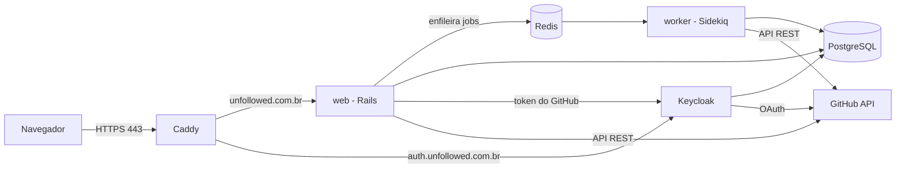
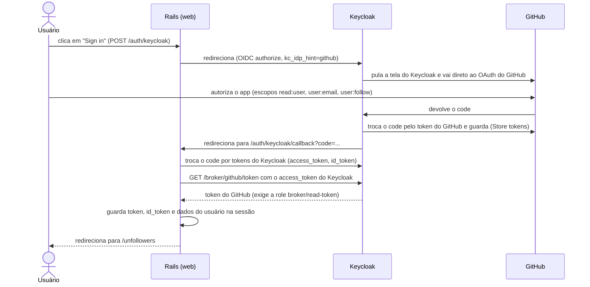

# Unfollowed

Lista as contas do GitHub que você segue e que não seguem você de volta, e permite deixar de seguir uma a uma ou todas de uma vez.

## Arquitetura

### Visão geral



Tudo roda em containers do mesmo `docker-compose.yml`, em uma única VPS de **4 GB de RAM e 2 vCPUs**. Esse tamanho foi o ponto de partida do desenho: cada peça abaixo foi escolhida por ser leve, ou por dispensar um serviço a mais.

Consumo real medido com `docker stats` na VPS, com a stack em repouso:

| Container | Memória | % dos 3,82 GiB |
|---|---|---|
| keycloak | 391,2 MiB | 10,0% |
| web (Rails) | 148,5 MiB | 3,8% |
| worker (Sidekiq) | 132,0 MiB | 3,4% |
| db (PostgreSQL) | 27,9 MiB | 0,7% |
| caddy | 12,1 MiB | 0,3% |
| redis | 3,7 MiB | 0,1% |
| **Total** | **≈ 715 MiB** | **≈ 18%** |

A stack inteira usa cerca de 0,7 GiB e a CPU fica abaixo de 1% em repouso, então sobra bastante folga para picos, para o build das imagens e para o sistema. O Keycloak sozinho é mais da metade do total.

### Componentes e motivos

| Componente | Papel | Por que |
|---|---|---|
| **Docker Compose** | Orquestra web, worker, Redis, PostgreSQL, Keycloak e Caddy | Uma VPS pequena não justifica Kubernetes. Um arquivo descreve toda a stack, o ambiente é igual em dev e prod, e sobe com um comando. |
| **Rails 8** | Aplicação web | Entrega rápida de uma app com sessão, views, i18n, jobs e cache já integrados, sem depender de um front-end separado. As telas usam Hotwire (Turbo e Stimulus), sem build de JavaScript. |
| **PostgreSQL 17** | Banco do Rails e do Keycloak | Uma única instância serve aos dois, com bancos separados (o `keycloak` é criado por `docker/postgres/init-keycloak-db.sh`). Isso economiza memória, que é o recurso mais escasso nessa VPS. Em produção também guarda o cache e a fila de cable (Solid Cache e Solid Cable). |
| **Redis 7** | Backend da fila do Sidekiq | É o que o Sidekiq exige. Fica só com essa função, com persistência (`appendonly`) para os jobs não se perderem num reinício. |
| **Sidekiq** | Executa os unfollows em segundo plano | Ver [Uso do Sidekiq](#uso-do-sidekiq). |
| **Keycloak 26** | Login (OIDC) e broker do GitHub | Ver [Fluxo de login](#fluxo-de-login-keycloak--github). É o maior consumidor de memória da stack (≈ 391 MiB, mais da metade do total), então vale como decisão consciente: em troca, o app não implementa OAuth, sessões, políticas nem tela de login. |
| **Caddy 2** | Proxy reverso e TLS | Ver [Por que Caddy e não Nginx](#por-que-caddy-e-não-nginx). |
| **`.env`** | Configuração e segredos | Ver [Configuração por `.env`](#configuração-por-env). |
| **systemd** | Sobe a stack junto com a VPS | Ver [Service do systemd](#service-do-systemd). |

### Por que Caddy e não Nginx

- **TLS automático:** o Caddy obtém e renova os certificados do Let's Encrypt sozinho. Com Nginx seria preciso Certbot, um cron ou timer de renovação e o recarregamento do serviço, mais peças para quebrar.
- **Configuração mínima:** todo o proxy cabe em poucas linhas em [docker/caddy/Caddyfile](docker/caddy/Caddyfile): um bloco por domínio com `reverse_proxy`. O equivalente em Nginx exige blocos `server`, `proxy_set_header`, redirecionamento 80→443 e caminhos de certificados.
- **Headers corretos por padrão:** `X-Forwarded-*` já vêm tratados, o que o Rails precisa para `force_ssl` e `assume_ssl`.
- **Consumo baixo:** binário único em Go, adequado à VPS pequena.

O custo é um ecossistema menor que o do Nginx e menos ajuste fino. Para duas rotas de proxy, isso não faz diferença.

### Configuração por `.env`

Todo valor que muda entre ambientes ou que é segredo fica no `.env`: banco, Keycloak, domínios, e-mail do ACME, `RAILS_MASTER_KEY`, senha do Sidekiq Web. O arquivo não vai para o git. O repositório traz `.env.development.example` e `.env.production.example` como modelos, e o `docker-compose.yml` carrega o `.env` em cada serviço (`env_file`). Assim, o mesmo código e o mesmo compose servem a dev e a prod, e trocar de ambiente é trocar o arquivo.

### Services (organização do código)

A lógica de negócio fica em objetos de serviço em [app/services/](app/services), não em controllers ou models.

- **Interface única:** todos herdam de [ServiceInterface](app/services/service_interface.rb): `Service.call(...)` devolve o próprio serviço, com `result` e `errors`. Quem chama só precisa checar `errors.any?`, sem exceções para controlar o fluxo.
- **Pastas por domínio:** `Github::Authentication`, `Github::Relations`, `Github::Users`, `Github::Following`. Cada serviço faz uma coisa (buscar relações, buscar usuários, deixar de seguir, orquestrar a lista de unfollowers).
- **Providers:** quem fala com o mundo externo (Octokit, Keycloak) fica em `providers/`, e o serviço recebe o provider como parâmetro. Isso **desacopla** a regra da biblioteca: trocar o Octokit, ou simular o GitHub nos testes, não mexe no serviço.
- **Controllers e jobs finos:** só recebem a requisição, chamam um service e respondem. Os jobs também só chamam services.
- **Manutenção e testes:** como cada peça é pequena e recebe tudo por parâmetro, os testes são unitários e rápidos (`spec/services`), sem precisar subir o GitHub ou o Keycloak.

### Consumo da API do GitHub

O app usa a API REST do GitHub pelo gem **Octokit**, sempre com o token do próprio usuário (ver o fluxo abaixo), com escopos `read:user`, `user:email` e `user:follow`:

1. Lista quem o usuário **segue** e quem o **segue** (paginado, ver abaixo).
2. A diferença entre as duas listas são os *unfollowers*.
3. O unfollow chama `DELETE /user/following/:login`.

Como o limite de requisições do GitHub é por token, a lista é guardada em cache (ver [Uso do cache](#uso-do-cache)) e os unfollows em lote passam pelo Sidekiq, em vez de rodarem dentro de uma requisição web.

### Uso do Sidekiq

O unfollow, individual ou em lote, roda em jobs ([UnfollowUserJob](app/jobs/unfollow_user_job.rb) e [UnfollowAllJob](app/jobs/unfollow_all_job.rb)):

- **A requisição web não trava:** deixar de seguir centenas de contas leva tempo e depende da API do GitHub. O usuário recebe a resposta na hora e o trabalho segue em segundo plano.
- **Tolerância a falhas:** a fila fica no Redis, então um reinício não perde o trabalho pendente, e erros de uma conta não derrubam as demais (o resultado separa `unfollowed` e `failed`).
- **Memória sob controle:** o worker é um container à parte, com concorrência configurável por `SIDEKIQ_CONCURRENCY` (padrão **3**, definido em [worker/entrypoint.sh](worker/entrypoint.sh)). Esse número baixo é proposital para a VPS de 2 vCPUs.
- **Token protegido:** o token do GitHub não vai em texto puro para o Redis. Ele é criptografado antes de ser enfileirado ([JobsModules::GithubTokenCipher](app/jobs/jobs_modules/github_token_cipher.rb)) e só é aberto dentro do job.
- **Observabilidade:** o painel do Sidekiq fica em `/sidekiq`, protegido por Basic Auth (`SIDEKIQ_WEB_USERNAME` e `SIDEKIQ_WEB_PASSWORD`).

### Uso do cache

- **Lista de unfollowers:** o resultado da consulta ao GitHub é guardado por **1 minuto** (`CACHE_TTL` em [FetchUnfollowersService](app/services/github/fetch_unfollowers_service.rb)), com chave por usuário. Isso evita refazer as várias chamadas paginadas a cada clique ou página, protegendo o limite de requisições do GitHub. Depois de um unfollow, o job **apaga** essa chave, para a lista seguinte já vir atualizada.
- **Fragmentos de view:** páginas estáticas (Termos, Privacidade, Contato), o texto da home e o rodapé usam cache de fragmento. A chave inclui o idioma e um hash dos arquivos de tradução, então muda sozinha quando um texto muda. Não há expiração por tempo, só o limite de tamanho do cache.
- **Onde fica:** em produção, no **Solid Cache** (PostgreSQL, limite de 256 MB), sem precisar de outro serviço. Em desenvolvimento, em memória.
- **Não é cacheado:** a navbar, o botão de login e qualquer coisa com dados do usuário ou token CSRF.

### Service do systemd

Para a stack subir sozinha quando a VPS reinicia, e poder ser ligada e desligada com `systemctl`, o repositório traz [system_lib/unfollowed_app.service](system_lib/unfollowed_app.service). Ele é uma unit `oneshot` que roda `docker compose --profile production up -d`, e que com `enable` passa a iniciar no boot. O arquivo fica versionado junto com o código, e a VPS usa um link simbólico para ele, então um `git pull` atualiza o service. Passo a passo em [Subir com a VPS (systemd)](#subir-com-a-vps-systemd).

### Fluxo de login (Keycloak + GitHub)

O app **não** fala OAuth com o GitHub diretamente. O Keycloak fica no meio como *identity broker*: o Rails só conversa com o Keycloak (OpenID Connect), e o Keycloak conversa com o GitHub.



Passo a passo:

1. **Início:** o botão envia `POST /auth/keycloak` (OmniAuth com `openid_connect`). O parâmetro `kc_idp_hint=github` faz o Keycloak pular a própria tela de login e ir direto ao GitHub.
2. **Autorização no GitHub:** o usuário autoriza o OAuth App com os escopos acima. O GitHub devolve o `code` ao Keycloak.
3. **O Keycloak guarda o token do GitHub:** com *Store tokens* ligado no identity provider, ele troca o `code` e armazena o token do GitHub para aquele usuário.
4. **Callback no Rails:** o Keycloak volta para `/auth/keycloak/callback`, e o Rails troca o `code` por tokens do Keycloak.
5. **Obtendo o token do GitHub:** o Rails chama o endpoint do broker (`/broker/github/token`) com o `access_token` do Keycloak, em [Providers::KeycloakBroker](app/services/github/authentication/providers/keycloak_broker.rb). Isso só funciona se o usuário tiver a role `read-token` do client `broker`; sem ela o Keycloak responde 403 e o login mostra "Could not get your GitHub access token".
6. **Sessão:** o Rails guarda na sessão (cookie criptografado) o token do GitHub, o `id_token` e nome e e-mail do usuário, e leva para `/unfollowers`.
7. **Logout:** o Rails apaga a sessão e redireciona ao logout do Keycloak com `id_token_hint`, o que encerra a sessão lá sem tela de confirmação.

**Por que usar o Keycloak em vez de OAuth direto com o GitHub?** Ele concentra a identidade, as sessões e a política de login num serviço próprio. O app fica sem código de OAuth, e novos provedores de login podem ser adicionados no Keycloak sem alterar a aplicação.

**Fora do desenho:** o app não guarda usuários nem tokens em banco. Tudo vive na sessão do navegador e no Keycloak.

### Origem do código e ferramentas

- **Reaproveitamento:** boa parte da base (`docker-compose.yml`, scripts de entrada, a estrutura de services e providers, a configuração do Keycloak) veio de outros projetos meus, ou foi inspirada neles, e foi adaptada a este caso. Os demais projetos estão em [github.com/xitarps](https://github.com/xitarps).
- **GitHub Copilot no VS Code:** usado principalmente no front-end (CSS, telas, estados de loading), na documentação e nos testes.

## Testes

Execute toda a suíte com RSpec:

```sh
bundle exec rspec
```

## Docker Compose

Crie o arquivo de ambiente e suba a stack:

```sh
test -f .env || cp .env.development.example .env
docker compose up --build
```

Serviços:

- `web`: Rails em http://localhost:3000
- `redis`: Redis 7, usado pelo Sidekiq
- `worker`: processador de jobs Sidekiq
- `db`: PostgreSQL 17, compartilhado pela aplicação e pelo Keycloak (o banco `keycloak` é criado por `docker/postgres/init-keycloak-db.sh` na primeira inicialização do volume)
- `keycloak`: Keycloak em http://localhost:8080. O modo vem de `KEYCLOAK_COMMAND` no `.env` (`start-dev` em desenvolvimento, `start` em produção), via `docker/keycloak/entrypoint.sh`; admin em `KC_BOOTSTRAP_ADMIN_*`, dados no PostgreSQL
- `caddy` (profile `production`): proxy reverso com TLS automático (Let's Encrypt) para `APP_DOMAIN` e `KEYCLOAK_DOMAIN`

### Autenticação (Keycloak + GitHub)

O botão **Sign in** faz login via OIDC no Keycloak (realm `unfollowed`, importado de `docker/keycloak/realm/unfollowed-realm.json` com `--import-realm`), e o Keycloak autentica com o GitHub. `/unfollowers` só é acessível para usuários autenticados.

1. Crie um **GitHub OAuth App** (GitHub → Settings → Developer settings → OAuth Apps):
   - Homepage URL: `APP_URL` (ex.: `https://unfollowed.com.br`)
   - Authorization callback URL: `<KC_HOSTNAME>/realms/unfollowed/broker/github/endpoint` (ex.: `https://auth.unfollowed.com.br/realms/unfollowed/broker/github/endpoint`)
2. No `.env`, preencha `GITHUB_CLIENT_ID`, `GITHUB_CLIENT_SECRET`, `OIDC_CLIENT_SECRET` (qualquer segredo forte) e use `OIDC_IDP_HINT=github`.
3. Suba o stack. O realm só é importado na primeira vez; mudanças posteriores devem ser feitas no console do Keycloak.

Em desenvolvimento, deixe `OIDC_IDP_HINT` vazio para ver a tela de login do Keycloak e entrar com um usuário criado no console (http://localhost:8080, realm `unfollowed`).

### Unfollowers (quem você segue e não te segue de volta)

`/unfollowers` lista, com paginação, as contas que você segue e que não seguem você de volta, com botão **Unfollow** por conta e **Unfollow all** no topo (executado em background pelo Sidekiq, com pausa de 1s entre as chamadas por causa dos limites do GitHub).

O token do GitHub não passa pelo navegador: o Keycloak o guarda (broker) e o Rails o busca em `/realms/unfollowed/broker/github/token` logo após o login. A lógica fica em `app/services/github/` (orquestradores + `FetcherService`s + `Providers`, sobre `ServiceInterface`).

Requisitos no Keycloak (já vêm no `unfollowed-realm.json`; em um realm criado manualmente, ajuste em Identity providers → GitHub):
- **Store tokens** e **Stored tokens readable**: ligados
- **Default scopes**: `user:email read:user user:follow`

Usuários que já tinham feito login antes dessa mudança precisam ser apagados (Users → Delete) e entrar de novo, para o Keycloak guardar o token e conceder a role `read-token`. No OAuth App do GitHub, deixe **Expire user access tokens** desmarcado: o Keycloak não renova o token do GitHub.

### Produção (unfollowed.com.br)

1. Crie registros DNS `A` para `unfollowed.com.br`, `www` e `auth` apontando para o servidor, e libere as portas 80 e 443.
2. `cp .env.production.example .env`, preencha `RAILS_MASTER_KEY`, `ACME_EMAIL` e troque todos os `change-me`.
3. `docker compose --profile production up -d --build`

#### Subir com a VPS (systemd)

O arquivo [system_lib/unfollowed_app.service](system_lib/unfollowed_app.service) sobe e derruba toda a stack (`docker compose --profile production`).

```bash
# 1. Clone o projeto (o service assume `~/app/unfollowed`) e crie o .env
mkdir -p ~/app && git clone https://github.com/xitarps/unfollowed.git ~/app/unfollowed
cd ~/app/unfollowed && cp .env.production.example .env   # preencha os valores

# 2. Confira `User=` em system_lib/unfollowed_app.service (padrao: deploy)
#    (precisa estar no grupo docker: sudo usermod -aG docker $USER)
#    Link simbolico com caminho ABSOLUTO (relativo quebra, pois e resolvido a partir de /etc/systemd/system)
sudo ln -s "$HOME/app/unfollowed/system_lib/unfollowed_app.service" /etc/systemd/system/unfollowed_app.service
sudo systemctl daemon-reload

# 3. Use
sudo systemctl start unfollowed_app     # sobe (compila so se faltar imagem; a 1a vez demora, o comando espera)
sudo systemctl enable unfollowed_app    # sobe junto com a VPS
sudo systemctl disable unfollowed_app   # nao sobe mais com a VPS
sudo systemctl stop unfollowed_app      # derruba os containers
sudo systemctl reload unfollowed_app    # recompila e atualiza apos git pull
systemctl status unfollowed_app
```

`WorkingDirectory` precisa ser um caminho absoluto (o systemd nao aceita `~/...`). Se o usuario ou o diretorio forem outros, ajuste `User=` e `WorkingDirectory` no service e rode `sudo systemctl daemon-reload`. O caminho do `docker` pode ser conferido com `which docker`. O Docker precisa estar habilitado (`sudo systemctl enable docker`).

O Keycloak fica em https://auth.unfollowed.com.br; com `KEYCLOAK_BIND_ADDRESS=127.0.0.1` a porta 8080 não é exposta externamente. O TLS termina no Caddy, e `FORCE_SSL=true` ativa `assume_ssl`/`force_ssl` no Rails.

O Rails usa PostgreSQL (`DB_*` no `.env`); o `web` executa `db:prepare` ao iniciar. Em produção, os bancos de cache e cable usam o nome de `DB_NAME` com sufixo `_cache` e `_cable`.
O dashboard do Sidekiq fica em http://localhost:3000/sidekiq, com Basic Auth via
`SIDEKIQ_WEB_USERNAME` e `SIDEKIQ_WEB_PASSWORD`. Valores de produção:
`.env.production.example`.

A cobertura é gerada automaticamente pelo SimpleCov em `coverage/`.
